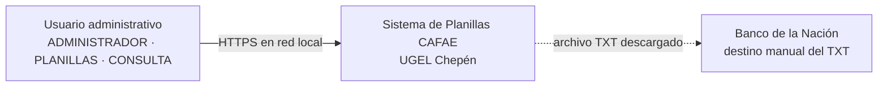
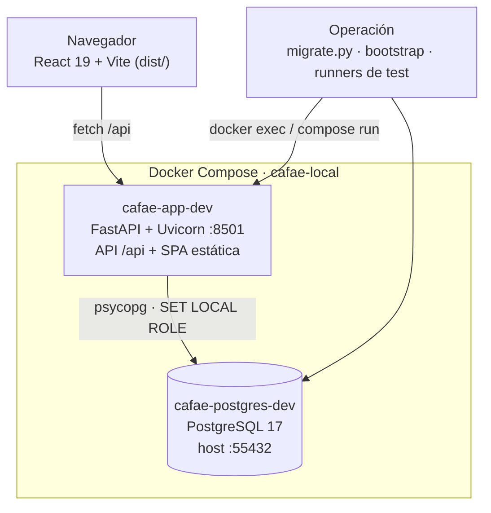
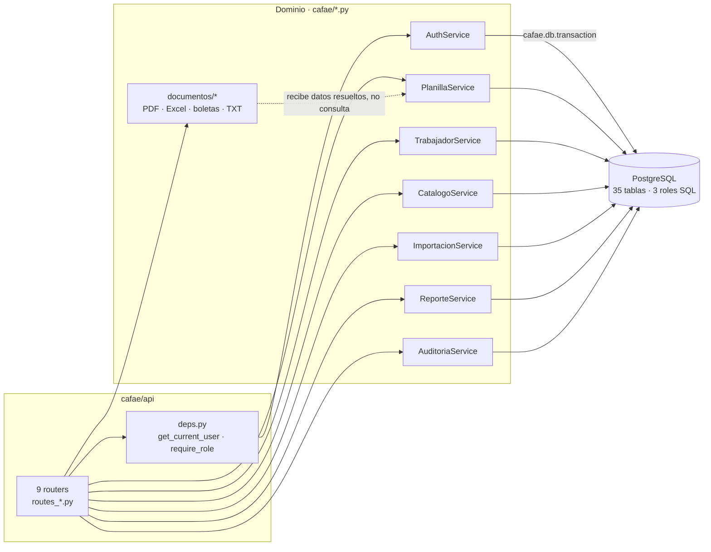
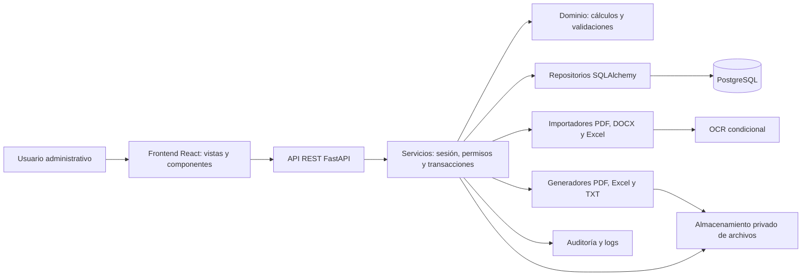

# Arquitectura

**Estado: implementado · revisión 28/10/2026.** La primera sección describe el
sistema real; la segunda conserva el diseño objetivo original del 24/09/2026.
Las diferencias y el porqué están en el [registro de ADR](adr/README.md).

> Regla de lectura: **§Estado implementado es la fuente de verdad**. §Diseño
> objetivo original explica la intención y las piezas que aún no existen (OCR,
> storage privado, pytest).

## Estado implementado (28/10/2026)

### C4 nivel 1 — Contexto



### C4 nivel 2 — Contenedores



### C4 nivel 3 — Componentes del backend



### Regla de dependencia

| Capa | Puede importar | No puede |
| --- | --- | --- |
| `frontend/src` | `/api` por HTTP | reglas de negocio, SQL |
| `cafae/api/routes_*` | `deps`, servicios, Pydantic | `cafae.db`, `psycopg` |
| `cafae/api/deps.py` | `AuthService`, `security` | servicios de dominio |
| `cafae/*.py` (servicios) | `cafae.db`, `security`, `calculos`, `documentos` | FastAPI |
| `cafae/documentos/*` | `calculos`, tipos | `cafae.db` |

**Estado**: ningún router ejecuta SQL ni abre transacciones. Los borrados de
catálogos, la lectura de versiones y los documentos pasan por sus servicios, y
una guardia AST (`tests/api/test_contrato.py`) falla si el SQL reaparece en la
capa HTTP.

### Inventario

| Elemento | Cantidad | Detalle |
| --- | --- | --- |
| Endpoints | 99 | catálogos 62 · documentos 8 · planillas 7 · trabajadores 5 · auth 4 · users 4 · importaciones 4 · auditoría 2 · reportes 2 · health 1 |
| Tablas | 35 | esquema `cafae` |
| Migraciones | 8 | `001`–`008`, inmutables por SHA-256 |
| Pruebas | 107 | `unittest`, 8 runners, base desechable `cafae_test_*` |
| UIs | 1 | React + Vite (ADR-005); Streamlit retirado el 28/10 |
| Logging estructurado | 0 | sin `logging` en `cafae/`; 3 `print` |

### Desviaciones frente al diseño original

| Diseño 24/09/2026 | Implementado | Registro |
| --- | --- | --- |
| SQLAlchemy + repositorios | `psycopg` + SQL en servicios | ADR-001 |
| Alembic | `scripts/migrate.py` con hash y advisory lock | ADR-002 |
| pytest | `unittest` + runners Docker | pendiente de ADR |
| `app/{domain,application,infrastructure}` | `cafae/` plano por dominio | ADR-001 |
| Importadores PDF/DOCX/OCR | solo Excel | fuera de alcance |
| Storage privado de archivos | documentos generados en memoria | por definir |
| Una sola UI | React + Streamlit → solo React | ADR-005 (ejecutado 28/10) |

### Deuda priorizada

| ID | Severidad | Hallazgo | Evidencia | Fase |
| --- | --- | --- | --- | --- |
| D-01 | Resuelto (era Crítico) | El TXT exige `txt_bancario`, está bloqueado por D.5 y solo se emite desde versión cerrada | `routes_documentos.py:20-42,168-208`; `tests/seguridad/` | 28/10 |
| D-02 | Resuelto (era Crítico) | Un solo esquema de credenciales: `Authorization: Bearer`; sin query string ni cabeceras alternativas | `api/deps.py`; `frontend/src/api/client.ts` | 28/10 |
| D-03 | Resuelto (era Alto) | Ningún router ejecuta SQL ni abre transacciones. Los 13 `DELETE ... RETURNING` de catálogos viven ahora en `CatalogoService._borrar_catalogo`, que traduce ausencia (`NoEncontrado` → 404) y uso (`Conflicto` → 409). Una guardia AST cubre los tres routers | `cafae/catalogos.py`; `tests/api/test_contrato.py` | 28/10 |
| D-04 | Resuelto (era Alto) | Cabecera, firmas y líneas de una versión salen de una sola transacción: `get_version_completa` y `get_linea_con_version`. Antes se armaban con dos y tres lecturas y podían mezclar revisiones | `cafae/planillas.py`; `routes_planillas.py`; `routes_documentos.py` | 28/10 |
| D-05 | Resuelto | Los ocho endpoints de documentos exigen `generar_documentos`; `txt_bancario` además exige versión cerrada y D.5 habilitado. `CONSULTA` solo lee | `routes_documentos.py:21-22,69-211`; `tests/seguridad/test_documentos.py` | 28/10 |
| D-06 | Resuelto (era Parcial) | Sobre de error uniforme (RFC 9457) con `code` estable, `403`/`401` para `AccessError`/`SessionError`, `409` para conflictos de revisión y `422` para validación. Ningún router captura `UserError`: los siete delegan en el handler global y una guardia AST lo verifica | `api/errors.py`; `api/main.py`; `tests/api/test_contrato.py` | 28/10 |
| D-07 | Resuelto (era Alto) | Los 62 endpoints de catálogos viven en un paquete por grupo (`bundle`, `institucional`, `presupuesto`, `personal`, `firmas`, `configuracion` + `_base` con modelos y servicio); el módulo más grande baja a 295 líneas y una prueba fija las 62 operaciones en OpenAPI | `cafae/api/routes_catalogos/` | 28/10 |
| D-08 | Medio | Sin logging estructurado ni ID de correlación | `cafae/**` (0 loggers, 3 `print`) | 6 |
| D-09 | Medio | CORS `*` con credenciales, innecesario en mismo origen | `main.py:52-58` | 4 |
| D-10 | Resuelto (era Medio) | Contrato tipado en el cliente: `apiRequest<T>` sin `any`, `ApiError` sobre RFC 9457, `Pagina[T]` estándar y `usePaginacion`. Queda un `any` documentado en `ReportesView` porque los 9 reportes no tienen esquema propio | `frontend/src/api/`; `frontend/src/hooks/usePaginacion.ts` | 2 |
| D-11 | Medio | Conexión nueva por transacción, sin pool: techo de concurrencia desconocido | `cafae/db.py:17-23` | 3 (medir) |
| D-12 | Bajo | Este documento describía un sistema distinto al implementado | `docs/02-arquitectura.md` | 1 (resuelto) |

**Hotfix 28/10/2026.** D-01, D-02 y D-05 quedaron cerrados:
`GET /api/documentos/banco-txt/{id}` y `banco-txt-resumen` exigen permiso
`txt_bancario` (ADMINISTRADOR/PLANILLAS), responden `403` mientras D.5 siga
vigente (`CAFAE_TXT_BANCARIO=1` es la única habilitación) y exigen versión
`CERRADA`. El resto de documentos (PDF, Excel, remuneraciones, boletas y
cuadernillo) exigen `generar_documentos`, y `CONSULTA` conserva solo lectura.
Pruebas: `python scripts/test_seguridad.py` (15 casos).

**Contrato de API 28/10/2026.** Todo error sale como `application/problem+json`
con `type`, `title`, `status`, `code`, `detail` e `instance`
([`docs/11-contrato-api.md`](11-contrato-api.md)); el conflicto de revisión
detectado en la base responde `409 CONFLICTO_REVISION` en vez de `500`, y
`POST /api/planillas` devuelve la `revision_edicion` vigente. Los listados que
crecen sin techo usan el sobre `Pagina[T]` (`GET /api/auditoria`) y el cliente
ramifica por `code`. Ningún router de dominio captura `UserError`: se quitaron
55 mapeos locales (48 en catálogos, 5 en trabajadores, 2 en reportes) y una
guardia AST falla si reaparecen. Pruebas: `python scripts/test_api.py` (28
casos, sin base de datos).

**Lectura consistente de versiones 28/10/2026.** `GET /api/planillas/versiones/{id}`
y los ocho endpoints de documentos armaban la respuesta con dos y tres
transacciones distintas: cabecera, firmas y líneas podían venir de revisiones
diferentes si alguien editaba o cerraba la planilla en el medio. Ahora
`PlanillaService.get_version_completa` y `get_linea_con_version` leen todo en
una sola transacción, y los dos routers dejaron de contener SQL. Los servicios
pueden señalar un recurso ausente con `NoEncontrado`, que el API traduce a
`404 NO_ENCONTRADO`.

**Borrado de catálogos en el servicio 28/10/2026.** Los once `DELETE` de
catálogos ejecutaban SQL y capturaban `ForeignKeyViolation` dentro del router.
Ahora `CatalogoService` expone `delete_nivel`, `delete_institucion`,
`delete_area_sede`, `delete_meta`, `delete_firma`, `delete_programa`,
`delete_partida`, `delete_cargo`, `delete_categoria`, `delete_situacion` y
`delete_subtipo`, todos sobre un `_borrar_catalogo` que distingue los dos
desenlaces posibles: `NoEncontrado` si el registro no existe y `Conflicto` si
sigue en uso. El API traduce el segundo a `409 CONFLICTO_ESTADO`, así que un
catálogo con dependencias ya no comparte código con un rechazo de validación.
`routes_catalogos.py` bajó de 992 a 879 líneas y quedó libre de psycopg; la
guardia `SinSqlEnRouters` ahora también lo cubre. Pruebas: 106 en total, con
cuatro casos nuevos de borrado contra PostgreSQL.

**Catálogos partidos por grupo 28/10/2026.** Ese mismo archivo se convirtió en
el paquete `cafae/api/routes_catalogos/`: `_base.py` reúne los modelos de
entrada y la instancia del servicio, y los endpoints se agrupan en `bundle`,
`institucional`, `presupuesto`, `personal`, `firmas` y `configuracion`. El
prefijo `/catalogos` se aplica una sola vez en `__init__.py`, que también
reexporta las rutas históricas. El módulo más grande es `institucional.py` con
295 líneas. No cambió ningún path ni método: 62 operaciones antes y después, y
una prueba las fija contra el esquema OpenAPI para que una mudanza futura no
pierda endpoints en silencio. La guardia de SQL ahora recorre todos los
archivos del paquete, no solo su `__init__`. Pruebas: 107.

**Retiro de Streamlit 28/10/2026.** Se ejecutó el plan de ADR-005: se
eliminaron `app.py`, `cafae/ui/` y `.streamlit/`, la dependencia `streamlit`
salió de `requirements.txt` y `requirements.lock`, el `Dockerfile` dejó de
copiar `app.py` y el healthcheck de `compose.yaml` apunta a `/api/health`.
Los cuatro casos de UI basados en `AppTest` se retiraron de
`tests/auth/test_auth.py`; la suite completa pasa sin `streamlit` instalado.

### Riesgos abiertos

- **Capacidad desconocida**: sin pool ni métricas no se puede afirmar cuántos
  usuarios concurrentes soporta el sistema.
- **Token en `localStorage`**: un XSS escala a robo de sesión completa.
- **TXT bancario**: el formato ya está implementado y probado, pero D.5 lo
  mantiene bloqueado hasta la especificación oficial.
- **Dos fuentes de reglas**: triggers en la base y validaciones en servicios
  pueden divergir; la mitigación son las pruebas de integridad existentes.

## Diseño objetivo original (24/09/2026)

Las [decisiones confirmadas](08-decisiones-confirmadas.md) fijan un solo ingreso, el importe de Sede desde REMUN. TOTAL y ocho descuentos en ambos formatos. Se retiran los conceptos adicionales de los nuevos documentos. Las firmas son cuatro en II.EE. y tres en Sede, con personas y cargos configurables; Gestión Administrativa corresponde al formato de II.EE.

## Capas y dependencias

Monolito modular: un despliegue inicial sencillo, con módulos separados y una única base de datos. La interfaz React presenta formularios y tablas consumiendo la API REST (FastAPI); no concentra reglas de negocio ni SQL.



La interfaz llama a servicios con identidad autenticada. Los servicios verifican permisos, validan entradas, bloquean la versión y ejecutan repositorios en una unidad de trabajo. El dominio usa objetos y `Decimal`, sin dependencia de la UI ni Pandas. Los generadores reciben un contrato de datos histórico y no consultan el maestro.

## Componentes

| Componente | Responsabilidad |
|---|---|
| React + Vite / FastAPI | Interfaz en español, navegación, sesión de presentación, formularios y edición por lote |
| SQLAlchemy / psycopg | Acceso parametrizado a PostgreSQL; repositorios y transacciones |
| Alembic | Migraciones revisables y versionadas, separadas del arranque de la aplicación |
| PostgreSQL | Relaciones, unicidad, importes exactos, historial, auditoría e índices |
| Pandas | Tablas de presentación y transformaciones de importación; no cálculo monetario con float |
| OpenPyXL / XlsxWriter | Inspección y generación de Excel, estilo y configuración de impresión |
| ReportLab | Diseño medido de planillas, boletas y hoja de remuneraciones |
| pdfplumber / pypdf | Extracción de tablas/texto y lectura de PDF; elegir según pruebas reales |
| python-docx | Lectura de párrafos y tablas de DOCX |
| OCR local | OCR por página solo si no hay texto utilizable; rasterizador y motor por definir y verificar |
| argon2-cffi | Hash Argon2id, verificación y actualización del hash cuando cambien parámetros |
| pytest | Pruebas de dominio, servicios, integración y regresión documental |

Las versiones exactas se fijarán después de probar compatibilidad en el entorno elegido. Esta entrega no instala dependencias ni cambia servicios existentes.

## Estructura objetivo

Este árbol describe los módulos futuros; no indica que estén implementados.

```text
proyecto_planillas/
  frontend/                       # Aplicación React + Vite
  cafae/                          # Backend modular y API FastAPI
  pyproject.toml
  .env.example                    # nombres de variables, nunca credenciales reales
  app/
    config.py
    bootstrap.py
    domain/
      dinero.py
      planillas.py
      descuentos.py
      validaciones.py
      permisos.py
      contratos_documentos.py
    application/
      auth.py
      usuarios.py
      catalogos.py
      trabajadores.py
      planillas.py
      importaciones.py
      cierre.py
      documentos.py
      reportes.py
      auditoria.py
    infrastructure/
      database.py
      models/
      repositories/
      storage.py
      security.py
      logging.py
      imports/
        pdf.py
        docx.py
        excel.py
        ocr.py
        normalizacion.py
      exports/
        planilla_iiee.py
        planilla_sede.py
        excel.py
        remuneraciones.py
        boletas.py
        txt_bancario.py
    ui/
      components/                 # encabezados, métricas, badges, confirmaciones
      login.py
      dashboard.py
      trabajadores.py
      instituciones.py
      sede.py
      planillas.py
      importaciones.py
      historial.py
      documentos.py
      reportes.py
      configuracion.py
      usuarios.py
      auditoria.py
  assets/
    styles.css
    logo.png                      # únicamente el logo recibido
  templates/
    originals/                    # referencias privadas, fuera del repositorio público
    planilla_iiee/
    planilla_sede/
    boleta/
    remuneraciones/
    txt/                          # contrato extraído del Excel, no inventado
  database/
    schema_propuesto.sql
    migrations/
  tests/
    unit/
    integration/
    documents/
    fixtures/                     # datos sintéticos o anonimizados
  scripts/
    bootstrap_admin.py            # comando local, sin administrador predeterminado
    backup.ps1
    restore.ps1
  docs/
  storage/                        # privado, respaldado, excluido de Git
```

## Dinero y contratos de cálculo

Entradas de dinero como cadenas decimales validadas; cuentas y DNI siempre como texto. La tabla editable puede mostrar importes formateados, pero enviará cadenas o centavos enteros al dominio. No convertir importes a `float` para operar con Pandas ni usar `Decimal(float)`.

```text
licencia = redondear_2((importe / Decimal('30')) * dias_licencia)
total_descuentos = suma(descuentos de las siete entidades) + licencia
neto = importe - total_descuentos
remuneraciones[meta] = suma(importe), nunca suma(neto)
```

Las siete entidades editables son Pichincha, Caja Sullana, Sub-CAFAE, BRENTA, SITRASE, SITASE/FENTASE y Otros. Licencia es el octavo componente, derivado de días 0–30 y almacenado una sola vez en el detalle. Nunca crear además un descuento editable de licencia que pueda contarse dos veces.

Se rechazan importes negativos, NaN, infinito, valores fuera de rango y separadores ambiguos. El parser identifica explícitamente el formato del origen; `1,350.00`, `1350,00` y `1.350,00` no se normalizan eliminando puntuación indiscriminadamente. La regla de redondeo D04 debe contrastarse con los originales.

## Registro maestro y creación

Cada trabajador tiene ID interno y DNI administrativo único. Catálogos usan IDs y estado activo; ninguna desactivación elimina registros referenciados. El maestro conserva importe base, jornada, situación, datos personales y cuenta. Se registran fecha de creación y modificación.

Crear desde maestro copia a la versión todos los campos necesarios, meta resuelta y orden estable. Genera siete descuentos en cero, cero días de licencia y cero licencia. No actualiza posteriormente las copias de forma implícita.

Copiar mes anterior selecciona la versión concreta del mes calendario inmediatamente anterior, incluido diciembre/enero. Si no existe, no se elige otro mes silenciosamente. Copia personal, datos históricos, importes, cuentas, metas, descuentos y días, sin sustituirlos por el maestro actual. Las firmas se deben revisar para el nuevo periodo. La procedencia conserva el ID de la versión copiada.

## Edición concurrente y guardado

Cada versión tiene `revision_edicion`. La UI carga esa revisión, calcula una previsualización tras cada edición y envía el lote completo o sus diferencias al guardar. El servidor verifica permiso y sesión, toma `SELECT ... FOR UPDATE` sobre la versión, comprueba revisión y estado, valida todas las filas y escribe en una transacción. Incrementa revisión y registra auditoría. Un conflicto devuelve «Otra persona modificó esta planilla; actualiza antes de guardar». No sobrescribir.

El guardado no se ejecuta fila por fila. Autosave queda para después de disponer de idempotencia, conflictos y recuperación probados; inicialmente se muestra «Cambios sin guardar» y botón «Guardar cambios». Cambiar de periodo no debe descartar ediciones silenciosamente.

Toda escritura de detalles, descuentos o firmas debe adquirir el mismo bloqueo de versión, incluso importaciones y limpieza. No basta con que solo el cierre tome el bloqueo. Orden constante: planilla → versión → detalles.

## Importación segura y revisable

1. Seleccionar versión abierta y tipo de descuento antes de subir el archivo.
2. Validar tamaño, firma de archivo y tipo real. Conservar original privado, hash y usuario.
3. Extraer tablas/texto por página; en documentos mixtos aplicar OCR solo a páginas sin texto útil. Conservar página, fila y texto original para revisión.
4. Detectar y proponer columnas DNI, nombre y monto. Si hay varios montos posibles, exigir selección de columna o corrección; no adivinar. Excel también se admite aunque no sea la única fuente.
5. Normalizar y comparar exclusivamente por DNI con la versión de planilla seleccionada. Un DNI en el maestro pero fuera de esa planilla se muestra como «No encontrado en la planilla».
6. Marcar todas las apariciones de un DNI repetido; ninguna queda aplicable por defecto. Nombres discrepantes, OCR incierto y montos ambiguos pasan a revisión. El nombre nunca asigna otra identidad.
7. Mostrar contadores y tabla filtrable. Conservar texto original y correcciones por separado; registrar autor, motivo y fecha. Permitir elegir una aparición del duplicado; como máximo un valor final por DNI/tipo/lote.
8. Seleccionar explícitamente «Reemplazar todos los descuentos de este tipo» o «Actualizar solo DNI del archivo». Previsualizar cantidad e importe antes/después y registros excluidos. Reemplazar exige confirmación.
9. Antes de aplicar, comprobar sesión, permiso, estado, revisión de la planilla y resolución de duplicados. Si la versión cambió desde la previsualización, recalcular la previsualización.
10. En una única transacción: bloquear versión, revalidar, limpiar solo ese tipo cuando corresponda, aplicar seleccionados, recalcular, incrementar revisión y registrar lote, filas y auditoría. Rollback completo ante error.

Una clave de idempotencia evita aplicar dos veces un mismo lote confirmado. El hash del archivo advierte que ya se cargó, pero no lo prohíbe globalmente: un archivo puede usarse legítimamente en otro periodo. Un lote con cero filas válidas nunca limpia descuentos como efecto implícito. Aplicar un subconjunto válido requiere confirmación explícita de excluidos.

## Cierre, historia y reapertura

Cierre propuesto, ejecutado en una transacción:

1. Administrador confirma periodo, versión, personas, importes y las firmas del tipo: cuatro para II.EE., tres para Sede.
2. Se bloquea la versión y comprueba la revisión mostrada; no cerrar con cambios pendientes.
3. Se recalcula cada fila desde importes, descuentos y días usando el motor vigente. Se valida identidad, meta, categoría, institución/área, cuentas y observaciones; severidad final según D05/D06 y plantillas.
4. Se comprueba que existan exactamente las posiciones 1–4 para II.EE. o 1–3 para Sede y se copian nombre/cargo. Se validan sumas detalle → grupos → total.
5. Se almacenan licencia, descuentos totales y neto de cada fila, totales del cierre, versión de cálculo y observaciones aceptadas cuando la política lo permita.
6. Se registra usuario/fecha, se marca CERRADA y se audita. Todo debe confirmar o revertir junto.

Las migraciones de la etapa 1 implementan disparadores y privilegios que impiden INSERT/UPDATE/DELETE de datos de una versión cerrada, incluidos cambios a sus descuentos, firmas y totales. **No están incluidos en el DDL inicial de referencia**: la fuente ejecutable es `database/migrations`. Los roles técnicos de aplicación no son dueños de tablas ni superusuarios; el usuario de migración local se reserva para administración.

Reabrir no modifica la versión cerrada. El administrador confirma y da un motivo; el servicio bloquea la planilla y crea una nueva versión BORRADOR con copias relacionales del cierre. La versión previa sigue disponible. Solo puede existir una versión abierta por planilla; los reportes mensuales usan el último cierre y muestran aviso si hay una corrección abierta. El editor usa la última versión, abierta o cerrada.

## Documentos y TXT

Cada salida referencia versión de planilla, tipo, versión de plantilla/generador, usuario, fecha, hash, cantidad de personas y total. Para reproducción exacta se conserva el archivo emitido, aunque después cambien el generador o la plantilla. Una descarga de historial devuelve ese archivo; una regeneración crea otro registro, nunca sobrescribe el original.

Se permitirá vista preliminar de PDF/Excel de una planilla abierta con rótulo BORRADOR. Boletas, hoja de remuneraciones oficial y TXT se generan desde una versión cerrada. Los artefactos oficiales se archivan después de comprobar coherencia de datos y renderizado.

PDF II.EE.: A4 horizontal, columnas y proporciones medidas del original, cabeceras repetidas. PDF Sede: generador específico con agrupación por área y subtotales originales. No reutilizar un formato genérico para ambos.

El algoritmo de paginación reserva espacio para un bloque final indivisible: los ocho descuentos generales y las firmas correspondientes (cuatro II.EE., tres Sede). Se prueba que quede exclusivamente en la última página y debajo del detalle; si falta espacio, redistribuye las últimas filas para acompañarlo. No reducir fuentes ni omitir columnas para forzar el ajuste. La redistribución para retirar ingresos adicionales e incluir todos los descuentos está autorizada. Un bloque que no quepa en la página obliga a revisar las medidas de plantilla.

Excel conserva encabezados, combinaciones, formatos numéricos, bordes, anchos, alturas, totales, sección final y áreas de impresión. DNI/cuentas se escriben como texto. Texto que empiece por `=`, `+`, `-` o `@` se exporta como texto, no como fórmula. Cada plantilla tendrá prueba de apertura y representación impresa.

Remuneraciones agrupa importes históricos por código de meta y concilia su total con el importe de la planilla. Boletas usan únicamente la copia histórica, en el orden de la planilla; generación individual y un PDF conjunto con saltos comprobados.

TXT: adaptador bloqueado hasta analizar fórmulas y muestra bancaria. Contrato versionado de longitudes, posiciones, codificación, rellenos, decimales, cabecera/pie y orden. Prevalidación de faltantes, formato, netos cero/negativos, registros y total. Si existe cualquier línea inválida, no emitir el archivo definitivo ni excluirla silenciosamente. No transmitir pagos desde esta aplicación: el alcance solicitado es generar el archivo.

## Autenticación y autorización

Login local con usuario y contraseña, hash Argon2id y sal por contraseña. Nunca contraseñas en logs, auditoría, datos de prueba ni código. Administrador inicial mediante comando local e ingreso oculto; sin contraseña predeterminada. Restablecimiento administrativo con contraseña temporal hasheada y cambio obligatorio.

Sesiones con token aleatorio almacenado mediante hash en base de datos, vencimiento absoluto y por inactividad; token solo en sesión de servidor. `st.session_state` mantiene la presentación, no es la fuente de autoridad ni almacenamiento permanente. Al reiniciar conexión puede pedirse login otra vez. Se verifica en cada operación que usuario siga activo, sesión no revocada y permiso vigente. Cerrar sesión revoca la sesión. Cambiar contraseña/rol o desactivar usuario invalida sesiones activas.

No confundir `st.login()` con validación de contraseñas locales: el mecanismo nativo documentado usa OIDC. La implementación local será explícita y probada. Un proveedor institucional OIDC sería una decisión posterior, manteniendo autorización propia.

Defensas previstas: límite de intentos por cuenta/origen con respuestas genéricas, TLS en proxy, protección XSRF/CORS activa, secretos por entorno, consultas parametrizadas, archivos privados fuera de rutas públicas y mínimos privilegios. Las descargas también verifican rol y alcance; no usar enlaces públicos permanentes. Cachear solo datos seguros o con clave de identidad/permiso/versión; nunca compartir un DataFrame sensible entre sesiones sin control.

La matriz de roles vive en el servicio de autorización. La interfaz oculta acciones no permitidas por claridad, pero una llamada directa debe rechazarse igualmente. `CONSULTA` conserva solo lectura; la emisión de PDF, Excel, boletas y remuneraciones exige `generar_documentos`, y el TXT exige además `txt_bancario` y versión cerrada (ADR-006, aceptado el 28/10/2026).

## Operación y recuperación

Fecha/hora persistida con `timestamptz`, presentación `America/Lima`. Periodo explícito mes/año independiente del reloj. Logs técnicos con ID de correlación y sin contraseñas, tokens ni documentos completos. Al usuario se muestra un mensaje claro y referencia de error.

Auditoría de acceso, cambios de maestro, creación/copia/edición, importación, limpieza, cierre, reapertura, configuraciones y generación. Cabecera de evento y cambios por campo normalizados; registrar también fallos relevantes fuera de transacciones fallidas. Auditar es requisito transversal desde el primer módulo; la etapa 15 completa la consulta administrativa.

Backup de PostgreSQL y archivos privados en un conjunto recuperable, con inventario y hashes. Programación, cifrado, retención y ubicación institucional por definir. Restauración se prueba en un entorno aislado con conciliación de cierres y documentos; nunca ejecutar restore sobre producción por defecto. Separar credenciales de migración, aplicación y respaldo. Verificar restauración antes de uso real y después de cambios operativos relevantes.

La generación larga/OCR tendrá límite de recursos y estado persistente; comenzar con trabajos acotados y mover a un ejecutor separado si las mediciones lo justifican. Guardar archivo temporal, validar, mover a almacenamiento definitivo y luego registrar metadatos; limpiar huérfanos de forma controlada tras fallos. No mantener bloqueos de edición durante renderizados prolongados.

## Fuentes técnicas consultadas

- Exactitud monetaria: [PostgreSQL, tipos numéricos](https://www.postgresql.org/docs/current/datatype-numeric.html).
- Restricciones por fila y relaciones: [PostgreSQL, constraints](https://www.postgresql.org/docs/18/ddl-constraints.html).
- Exclusión de escritores concurrentes: [PostgreSQL, bloqueos explícitos](https://www.postgresql.org/docs/current/explicit-locking.html).
- API y especificación: [FastAPI Documentation](https://fastapi.tiangolo.com/).
- Hash de contraseñas: [OWASP, almacenamiento de contraseñas](https://cheatsheetseries.owasp.org/cheatsheets/Password_Storage_Cheat_Sheet.html).
