# Modelo entidad-relación y diccionario

**Actualización 24/09/2026:** las [migraciones ejecutables](../database/migrations) incorporan los campos laborales/boleta y la jerarquía de programas descubierta en las plantillas, además de partidas presupuestarias y controles de concurrencia. La base contiene 35 tablas en `cafae`, incluida `acceso_intentos` de la etapa 2. El diagrama y diccionario siguientes conservan el diseño inicial; las ampliaciones y pruebas están descritas en los informes de [base de datos](09-base-datos-implementada.md) y [acceso](10-acceso-y-usuarios.md).

El DDL propuesto está en [schema_propuesto.sql](../database/schema_propuesto.sql). Las claves primarias son internas. No se usa DNI como PK ni JSON para sustituir tablas. Las relaciones usan `NO ACTION` por defecto: no hay borrados en cascada de historia.

## Diagrama principal

```mermaid
erDiagram
    roles ||--o{ usuarios : autoriza
    usuarios ||--o{ sesiones : inicia
    niveles ||--o| nivel_metas : configura
    metas ||--o{ nivel_metas : asigna
    niveles ||--o{ instituciones : clasifica
    metas o|--o{ instituciones : asigna
    metas o|--o{ areas_sede : asigna
    instituciones o|--o{ trabajadores : adscribe
    areas_sede o|--o{ trabajadores : adscribe
    cargos o|--o{ trabajadores : clasifica
    categorias o|--o{ trabajadores : clasifica
    situaciones o|--o{ trabajadores : clasifica
    subtipos_trabajador o|--o{ trabajadores : clasifica
    niveles o|--o{ trabajadores : clasifica
    periodos ||--o{ planillas : agrupa
    planillas ||--o{ planilla_versiones : conserva
    planilla_versiones o|--o{ planilla_versiones : origina
    planilla_versiones ||--o{ planilla_detalle : contiene
    trabajadores ||--o{ planilla_detalle : participa
    planilla_detalle ||--o{ planilla_descuentos : recibe
    tipos_descuento ||--o{ planilla_descuentos : clasifica
    planilla_versiones ||--o{ planilla_firmas : congela
    firmas ||--o{ planilla_firmas : selecciona
    planilla_versiones ||--o{ importaciones : procesa
    tipos_descuento ||--o{ importaciones : clasifica
    archivos ||--o{ importaciones : respalda
    importaciones ||--o{ importacion_detalle : extrae
    planilla_detalle o|--o{ importacion_detalle : identifica
    planilla_versiones ||--o{ observaciones_planilla : valida
    planilla_versiones ||--o{ documentos_generados : emite
    archivos ||--o{ plantillas_documento : referencia
    plantillas_documento ||--o{ documentos_generados : define
    archivos ||--o| documentos_generados : conserva
    usuarios o|--o{ auditoria : realiza
    auditoria ||--o{ auditoria_cambios : detalla
    archivos o|--o| configuracion_institucional : logo
```

El diagrama muestra las relaciones funcionales principales. El DDL incluye también referencias de autoría, copia histórica de institución/nivel/meta y claves compuestas que garantizan que una fila importada o una boleta pertenezcan a la versión correcta.

## Tablas por responsabilidad

| Tablas | Contenido / claves relevantes |
|---|---|
| roles | Tres roles solicitados, código único; permisos iniciales definidos en servicios y probados |
| usuarios | Usuario único sin distinguir mayúsculas, nombre, hash, rol, estado y fechas; nunca contraseña |
| sesiones | Hash de token único, usuario, vencimiento, último acceso, revocación |
| metas | Código textual único, descripción y fechas; no equivalencias rígidas |
| niveles / nivel_metas | Catálogo y meta por defecto del nivel; una asignación actual por nivel |
| instituciones | Código modular textual único, nombre, nivel, distrito, meta opcional y estado |
| areas_sede | Nombre, meta opcional y estado |
| cargos / categorias / situaciones / subtipos_trabajador | Catálogos editables con desactivación lógica |
| firmas | Nombre/cargo actual y estado |
| trabajadores | ID interno, DNI único, todos los campos maestros, adscripción, importe base, fechas |
| periodos | Un registro por año/mes |
| planillas | Identidad lógica por periodo y tipo, autor y fecha; cantidad de firmas derivada: cuatro II.EE. / tres Sede |
| planilla_versiones | Número, origen, fuente, estado, revisión de edición, versión de cálculo, cierre y totales |
| planilla_detalle | Snapshot completo por trabajador/versión, orden, días, licencia calculada y resultados |
| tipos_descuento | Siete tipos editables; licencia calculada pertenece al detalle |
| planilla_descuentos | Un monto por detalle/tipo; autor y fecha de modificación |
| planilla_firmas | Posiciones 1–4 para II.EE. o 1–3 para Sede, con ID de origen y nombre/cargo histórico |
| archivos | Ruta privada lógica, MIME, tamaño, hash, autor/fecha; referencia tanto originales como resultados |
| importaciones | Periodo por versión, entidad, archivo, modalidad, revisión previsualizada, idempotencia, estadísticas |
| importacion_detalle | Fila/página/hoja, texto original, DNI/monto normalizados, match, estado, selección y resolución |
| observaciones_planilla | Resultado de validación ligado a una revisión; severidad y aceptación motivada de advertencias |
| plantillas_documento | Tipo, versión, archivo original, responsable y fecha de validación |
| documentos_generados | Versión de planilla/plantilla/generador, archivo, trabajador opcional, cantidad y total |
| configuracion_institucional | Nombre de institución/sistema, zona horaria y logo; singleton |
| auditoria / auditoria_cambios | Evento y diferencias por entidad/campo; acceso solo de lectura desde la UI |

`auditoria.entidad + entidad_id` es una referencia polimórfica informativa, no una FK: un evento puede describir una operación rechazada sobre una entidad que no llegó a existir. Las relaciones de negocio sí tienen claves foráneas. No guardar contraseñas, hashes de contraseñas o tokens en los cambios auditados.

## Normalización y fotografía histórica

El maestro usa FKs para catálogos. En los snapshots se guardan también sus etiquetas, porque una FK por sí sola mostraría el nombre actual, no el del periodo. Esta duplicación es intencional y acotada a historia.

| Dato mostrado | Fuente maestra | Fuente para versión histórica |
|---|---|---|
| DNI, nombres, apellidos | trabajadores | planilla_detalle |
| Código modular, institución, distrito | instituciones | planilla_detalle |
| Área y nivel | areas_sede / niveles | planilla_detalle |
| Meta | institución/área → nivel_metas | meta_codigo y meta_descripcion del detalle |
| Cargo, situación, categoría y subtipo | catálogos | etiquetas del detalle |
| Fecha de nacimiento, ley, régimen, jornada, cuenta | trabajadores | planilla_detalle |
| Importe | trabajadores | planilla_detalle, editable mientras abierta |
| Descuentos | No residen en trabajador | planilla_descuentos de esa versión |
| Licencia, total descuentos y neto | Motor de cálculo | valores persistidos en planilla_detalle |
| Firmas | firmas | planilla_firmas de esa versión |

La adscripción maestra puede cambiar sin mover a la persona entre planillas antiguas. La relación actual de metas puede editarse; la meta histórica permanece copiada. No se ejecutan refrescos automáticos del maestro sobre planillas cerradas ni abiertas ya creadas.

## Invariantes del DDL inicial

Esta matriz describe los límites del archivo histórico `schema_propuesto.sql`. Las protecciones de base señaladas como pendientes aquí ya se implementaron en las migraciones 003–006; los servicios, validaciones de interfaz y parsing de importaciones siguen pendientes. Consulte el informe de implementación para el estado vigente.

| Regla | DDL propuesto | Servicio / migración pendiente |
|---|---|---|
| DNI administrativo y formato | UNIQUE y regex de ocho dígitos | Normalizar, conservar ceros, explicar duplicado |
| Mes/año y planilla lógica únicos | UNIQUE de periodo y periodo/tipo | Resolver D01 antes de desarrollo |
| Una versión editable por planilla | Índice único parcial | Bloqueo de planilla al crear/reabrir |
| Worker/DNI/orden únicos en versión | Tres restricciones UNIQUE | Selección y carga de personal |
| Moneda exacta no negativa y finita | Dominios NUMERIC(12,2) acotados | Parsing Decimal sin float, control de escala y desbordamientos |
| Neto puede ser negativo en borrador | Dominio firmado y igualdad importe − descuentos | Advertencia y política de cierre D05 |
| Días 0–30 | CHECK | Cálculo y redondeo D04 |
| Total descuentos = siete montos + licencia | No se puede expresar con un CHECK de otra tabla | Motor único y validación transaccional/disparador antes del cierre |
| Firmas sin posiciones repetidas, según tipo | CHECK máximo 4, UNIQUE y cantidad calculada en planillas | Trigger de escritura/cierre: II.EE. exige 1–4, Sede 1–3 y rechaza posición 4 |
| Duplicados importados no seleccionados a la vez | Índice parcial importación/DNI | Detectar todas las apariciones antes de marcar IDENTIFICADO |
| Match pertenece a versión del lote | FKs compuestas | Verificar además igualdad del DNI, sin coincidencia por nombre |
| Cierre incluye responsable, fecha y totales | CHECK | Conciliar sumas reales y validar datos obligatorios |
| Copia/reapertura tiene fuente | FK y CHECK | Copia del mes previo; reapertura desde último cierre de misma planilla |
| Inmutabilidad de cierres | No implementada en este DDL | Triggers sobre versión, detalle, descuentos, firmas y validaciones; no permitir reparentar hijos |
| Inmutabilidad de importaciones aplicadas y archivos emitidos | No implementada | Triggers y privilegios; originales nunca sobrescritos |
| Auditoría anexada, nunca editada | Tablas definidas | Privilegios append-only y triggers; controles del servicio |
| actualizado_en | Valor inicial por defecto | Trigger en cada actualización maestra; no suponer actualización automática |
| Permisos efectivos | FKs de rol/usuario | Guardas de servicio + rol técnico restringido, sin privilegios DDL |

Los futuros triggers de protección deben bloquear la versión y revisar tanto `OLD` como `NEW`, evitando mover un detalle cerrado a una versión abierta para eludir la restricción. La protección se aplica a UPDATE, DELETE e INSERT de hijos. Los CHECK no sustituyen controles sobre conjuntos de filas.

## Índices y consultas

El DDL indexa unicidad, relaciones más consultadas, estado/fecha, trabajador, institución, meta, importación y auditoría. Para búsquedas parciales por nombre y código se medirán consultas con `EXPLAIN`; añadir `pg_trgm` solo si el volumen lo justifica. El índice btree de nombre no se presenta como solución a cualquier búsqueda `%texto%`.

Reportes normales toman el último cierre de cada planilla lógica; una pantalla de historia permite elegir cualquier versión y marca sus documentos. Nunca sumar todas las versiones. Comparación mensual alinea tipo e institución/meta y aclara faltantes; el importe por meta se calcula sobre snapshots.

Historial de trabajador consulta `planilla_detalle.trabajador_id` y auditoría, incluso si está inactivo. En las vistas se muestra moneda peruana `S/ 1,350.00`; la base conserva el número exacto, no el texto formateado.

## Estado de validación

Las seis migraciones se ejecutaron y reejecutaron correctamente en PostgreSQL 17.11. Se verificaron restricciones, inmutabilidad, permisos técnicos, conflictos concurrentes y restauración con datos sintéticos. La certificación de cálculos contra Excel, las operaciones completas desde servicios autenticados y la aceptación de documentos pertenecen a etapas posteriores. Véase la evidencia y sus límites en el [informe de implementación](09-base-datos-implementada.md).
